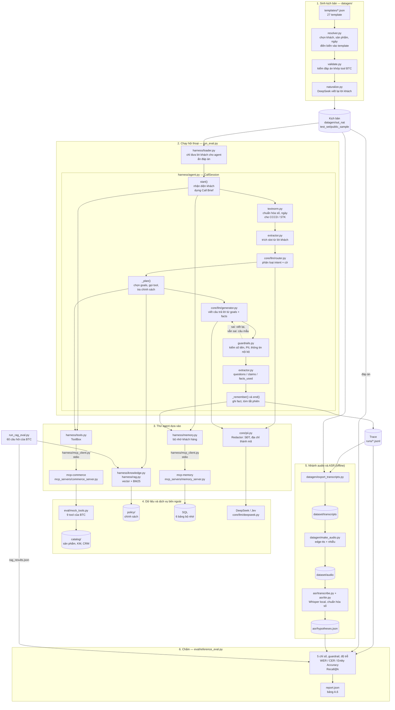
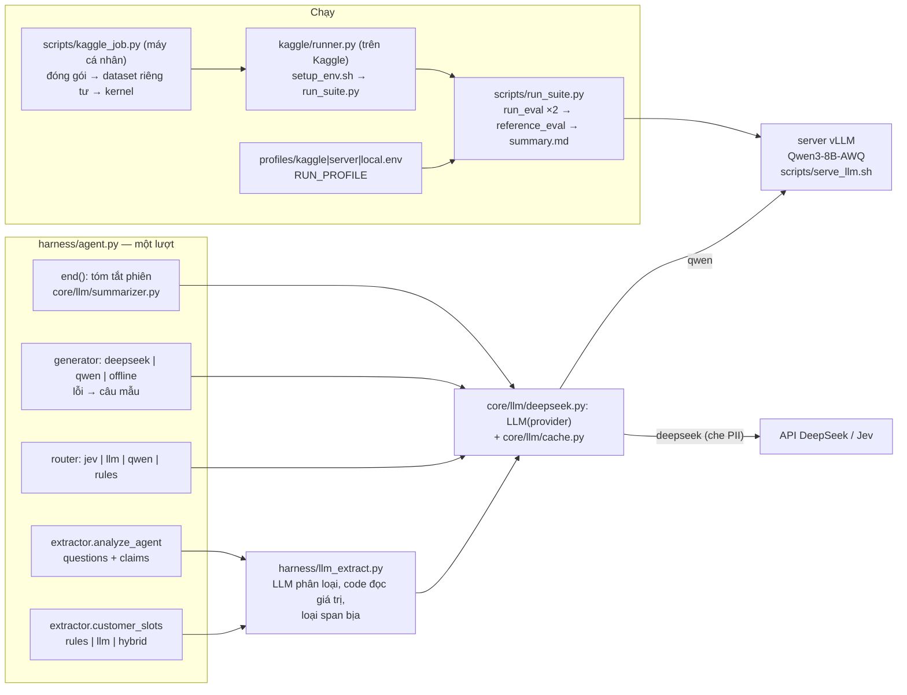

# Sơ đồ kiến trúc code

Sơ đồ này vẽ theo code đang có trong repo: file nào gọi file nào, dữ liệu đi từ đâu đến đâu. Thiết kế chi tiết và lý do chọn nằm ở [ARCHITECTURE.md](ARCHITECTURE.md); cách chạy nằm ở [HARNESS.md](HARNESS.md).

## Cách đọc

- **Đường chính** đi từ trên xuống: sinh kịch bản (1), chạy hội thoại (2), ghi trace, chấm (6).
- **Khối 2 là một lượt thoại.** `start()` chạy một lần đầu cuộc gọi; chuỗi từ `textnorm.py` đến `_remember()` lặp lại cho từng câu khách nói; `end()` chạy một lần cuối cuộc gọi.
- **Khối 3 và 4 là thứ agent gọi tới.** Với `--transport direct`, `tools.py` và `memory.py` gọi thẳng `mock_tools.py` và SQL, bỏ qua hai MCP server.
- **Khối 5 không nối vào agent.** Audio sinh ra từ transcript, chạy qua Whisper, rồi chỉ đi tới bước chấm.
- **Script chấm nhận hai đầu vào cho hội thoại:** trace của nhóm và đáp án trong kịch bản. Agent không bao giờ thấy đáp án, vì `loader.py` đã ẩn.

## Ghi chú

- `baseline_no_memory` dùng đúng các khối trên, chỉ tắt việc đọc bộ nhớ ở `start()`.
- Router có ba chế độ (Jev, DeepSeek, luật từ khóa); generator có hai (DeepSeek, câu mẫu). Chế độ không gọi API thì không đi qua `core/pii.py`.
- Các thư mục `eval/`, `catalog/`, `policy/`, `test_set/` là của BTC và không được sửa.
- Chưa có trong code nên không vẽ: cơ chế cải tiến (`improve/`) và giao diện Streamlit.

## Bổ sung 14/10/2026: model local, bộ trích LLM, chạy trên Kaggle/server

Mọi backend dùng Qwen gọi chung một server vLLM. Các worker gửi HTTP request tới server đó, không nạp model trong tiến trình. Chi tiết: [CHAY-KAGGLE-SERVER.md](CHAY-KAGGLE-SERVER.md).
